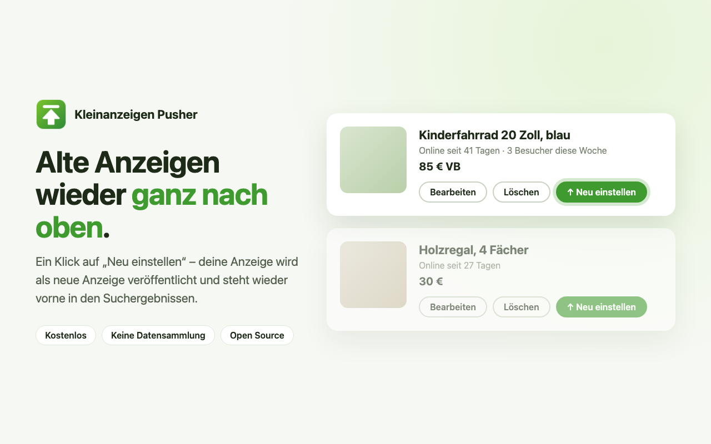

# Kleinanzeigen Pusher

Chrome extension that republishes your old [kleinanzeigen.de](https://www.kleinanzeigen.de) ads with one click so they show up at the top of search results again.

## How it works

1. On **Meine Anzeigen**, every ad gets a **Neu einstellen** button.
2. It opens the ad's edit page in recreate mode. When you click **Anzeige speichern**, the ad is submitted as a new ad instead of updating the old one.
3. Back on **Meine Anzeigen**, the extension finds the new ad and offers to delete the old one with one click.

No permissions, no tracking, nothing sent anywhere except to kleinanzeigen.de itself.

## Install

- From the [Chrome Web Store](https://chromewebstore.google.com/detail/onhggcafbggfadbghoplpafonnmigehb), or
- from source: `chrome://extensions` → enable *Developer mode* → *Load unpacked* → pick this folder.

## Development

Manifest V3, plain JavaScript, no build step.

| Path | Purpose |
| --- | --- |
| `src/common.js` | Shared helpers (globals prefixed `ekp`), loaded before each page script. |
| `src/my-ads.js` | *Meine Anzeigen*: adds the *Neu einstellen* buttons and the delete-old-ad banner. |
| `src/edit-ad.js` | Edit page with `&ekp=recreate`: submits the form as a new ad. |
| `src/styles.css` | Styles for the injected UI; every class is prefixed `ekp-`. |
| `assets/logo.svg` | Source of all icons. |
| `store/` | Store listing text, icon, screenshots and promo tile; `store/src/*.html` are the image sources. |
| `scripts/` | `render-store-assets.sh` renders icons and store images, `package.sh` builds the upload zip. |

Rules: no extension permissions, no remote code, no requests to hosts other than kleinanzeigen.de (the store privacy declaration depends on it), and never delete anything without an explicit click. User-facing text is German.

### What the extension relies on

Kleinanzeigen changes its frontend regularly. When something breaks, check these first:

- **Meine Anzeigen** (`/m-meine-anzeigen.html`) is rendered client-side by React. Each ad has an edit link `/p-anzeige-bearbeiten.html?adId=<id>`. The list re-renders, so injection runs from a `MutationObserver`.
- **Edit page** (`/p-anzeige-bearbeiten.html?adId=<id>`) submits `new FormData(form)` to the Astro actions `postListingWeb.submitListing` / `validateListing`. A hidden `adId` input decides between update and new ad. The extension blanks `adId` in the `formdata` event; changing the DOM input does not work because React restores it.
- **Ad data**: `GET /m-meine-anzeigen-verwalten.json?pageNum&pageSize&keyword` returns `{ ads: [...] }`.
- **Delete**: `POST /m-anzeigen-loeschen.json?ids=<id>` with header `X-CSRF-TOKEN` from `GET /m-mein-profil.json` (`csrfToken`).
- `/p-anzeige-kopieren.html?adId=<id>` ("Als Vorlage verwenden") is PRO-only, so it is not used.

### Testing

No automated tests. Load the extension unpacked (reload it on `chrome://extensions` after changes) and check with a real ad:

1. Every ad on *Meine Anzeigen* shows *Neu einstellen*, also after paging or filtering, without duplicates.
2. Clicking it opens the edit page with the banner; *Anzeige speichern* creates a new ad and leaves the old one untouched.
3. Back on *Meine Anzeigen* the delete banner appears; *Alte Anzeige löschen* removes only the old ad.

### Release

1. Bump `version` in `manifest.json`.
2. If logo or store sources changed, run `scripts/render-store-assets.sh` (needs `rsvg-convert` and Google Chrome).
3. Run `scripts/package.sh` and upload `dist/kleinanzeigen-pusher-<version>.zip` in the [developer dashboard](https://chrome.google.com/webstore/devconsole). Update the listing from `store/listing.md` if the text changed.

Not affiliated with Kleinanzeigen GmbH.
